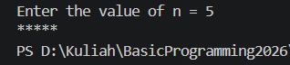
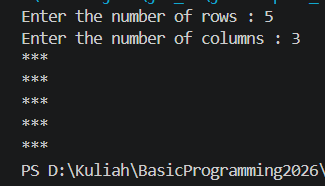
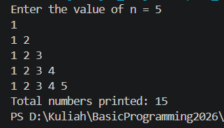
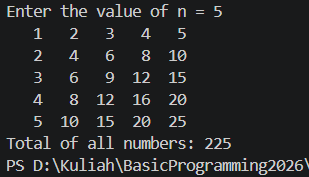

# JOBSHEET 8 - LOOPS 2

**Student Identity:**

- **Name:** Muhamad Dzaky Ammar Naufal
- **Student ID (NIM):** 264107020222
- **Class / Attendance No.:** 1I / 21

---

## 1: PRACTICAL OBJECTIVES

The objectives of this practical session are:

1. Students understand the concept of nested loops in algorithms.
2. Students understand the flow of nested loops.
3. Students recognize the syntax of nested loops.
4. Students are able to apply nested loops to solve a simple case study.

---

## 2: EXPERIMENT RESULTS AND ANALYSIS

### 2.1 Experiment 1: Review of Loops 1

This experiment revisits the `for` loop. The program prints the character `*` n times side by side, so `print` is used instead of `println`, and `System.out.println();` is called after the loop to move the cursor to a new line.

#### 2.1.1 Java Program Code (`Star21.java`)

```java
import java.util.Scanner;

public class Star21 {
    public static void main(String[] args) {
        Scanner sc = new Scanner(System.in);
        System.out.print("Enter the value of n = ");
        int n = sc.nextInt();

        for (int i = 1; i <= n; i++) {
            System.out.print("*");
        }
        System.out.println();
        sc.close();
    }
}
```

#### 2.1.2 Program Output

Input n = 5:



Input n = 3 and n = 7:

```text
Enter the value of n = 3
***
```

```text
Enter the value of n = 7
*******
```

| n | Number of `*` printed |
| --- | --- |
| 3 | 3 |
| 5 | 5 |
| 7 | 7 |

#### 2.1.3 Answers to Questions

* **Question 1:** If the initialization `i = 1` is changed to `i = 0` without changing the condition, how many `*` characters are printed when n = 5? Explain.
  * **Answer:** Six `*` characters are printed. The loop starts at `i = 0` and continues while `i <= 5`, so it runs for `i = 0, 1, 2, 3, 4, 5`, which is 6 iterations.

* **Question 2:** If the condition `i <= n` is changed to `i < n`, how many times does the loop run when n = 5? Why is the result different?
  * **Answer:** The loop runs 4 times (`i = 1, 2, 3, 4`). The result is different because `i < n` stops the loop as soon as `i` reaches 5, so the last value `i = n` is no longer processed.

* **Question 3:** Predict the output of the code fragment when n = 9, then modify it so it prints the odd positive numbers that do not exceed n.
  * **Answer:** The fragment starts at 2 and adds 2 each time, so it prints the even numbers:

    ```text
    2 4 6 8 
    ```

    To print the odd positive numbers that do not exceed n, the loop starts at 1:

    ```java
    for (int i = 1; i <= n; i += 2) {
        System.out.print(i + " ");
    }
    ```

    For n = 9, the output is `1 3 5 7 9`.

* **Question 4:** Explain why changing the increment `i++` to `i--` (with the condition still `i <= n`) makes the loop run endlessly.
  * **Answer:** `i` starts at 1 and decreases (0, -1, -2, ...), so it always stays smaller than `n`. The condition `i <= n` therefore never becomes false, and the loop keeps printing without stopping in a reasonable time. It can only be stopped manually with **Ctrl + C**.

---

### 2.2 Experiment 2: Rectangle Star Pattern (Nested FOR)

This experiment uses a nested `for` loop. The outer loop controls the rows, while the inner loop controls the columns.

#### 2.2.1 Java Program Code (`Rectangle21.java`)

```java
import java.util.Scanner;

public class Rectangle21 {
    public static void main(String[] args) {
        Scanner sc = new Scanner(System.in);
        System.out.print("Enter the number of rows: ");
        int rows = sc.nextInt();
        System.out.print("Enter the number of columns: ");
        int columns = sc.nextInt();

        for (int i = 1; i <= rows; i++) {
            for (int j = 1; j <= columns; j++) {
                System.out.print("*");
            }
            System.out.println();
        }
        sc.close();
    }
}
```

#### 2.2.2 Program Output

Input rows = 5 and columns = 3:



Input rows = 3 and columns = 6:

```text
Enter the number of rows: 3
Enter the number of columns: 6
******
******
******
```

Input rows = 4 and columns = 2:

```text
Enter the number of rows: 4
Enter the number of columns: 2
**
**
**
**
```

Input rows = 1 and columns = 5:

```text
Enter the number of rows: 1
Enter the number of columns: 5
*****
```

The shape of the output follows the input: the number of lines equals `rows` and the number of `*` in each line equals `columns`.

#### 2.2.3 Answers to Questions

* **Question 1:** Explain the function of the variables `i` and `j` in the program.
  * **Answer:** `i` is the counter of the outer loop and represents the current row. `j` is the counter of the inner loop and represents the current column in that row.

* **Question 2:** How many times are the outer loop, the inner loop, and the statement `print("*")` executed for rows = 4 and columns = 7?
  * **Answer:** The outer loop runs 4 times. For each outer iteration the inner loop runs 7 times, so the inner loop body runs 4 x 7 = 28 times in total. The statement `print("*")` is therefore executed 28 times.

* **Question 3:** What happens if the bounds of the outer and inner loops are swapped? Use rows = 3 and columns = 6.
  * **Answer:** The outer loop would run 6 times and the inner loop 3 times, so the output has 6 lines with 3 `*` each instead of 3 lines with 6 `*`. The total number of `*` stays the same (18), but the shape is rotated.

    ```text
    ***
    ***
    ***
    ***
    ***
    ***
    ```

* **Question 4:** Explain the effect of removing `System.out.println();` after the inner loop.
  * **Answer:** The cursor never moves to a new line, so all the `*` characters are printed on one single line. For rows = 3 and columns = 6, the output becomes `******************` (18 `*` in one line).

* **Question 5:** Modify the program so that the printed character is `#`.
  * **Answer:** Change the printed character inside the inner loop:

    ```java
    System.out.print("#");
    ```

    For rows = 3 and columns = 6, the output is:

    ```text
    ######
    ######
    ######
    ```

---

### 2.3 Experiment 3: Debugging a Star Triangle - Nested WHILE

The starter code in this experiment intentionally does not produce the correct triangle. The errors are fixed without changing the `while` loops into `for` loops, and an inverted triangle is added below the first triangle.

#### 2.3.1 Starter Code (contains errors)

```java
import java.util.Scanner;

public class Triangle21 {
    public static void main(String[] args) {
        Scanner sc = new Scanner(System.in);
        System.out.print("Enter the value of n = ");
        int n = sc.nextInt();

        int i = 0;
        while (i <= n) {
            int j = 0;
            while (j < i) {
                System.out.print("*");
                j++;
            }
            i++;
        }
        sc.close();
    }
}
```

Actual output of the starter code:

```text
Enter the value of n = 3
******
```

```text
Enter the value of n = 5
***************
```

Output with the temporary debug line `System.out.print("[i=" + i + "] ");` for n = 5:

```text
Enter the value of n = 5
[i=0] [i=1] *[i=2] **[i=3] ***[i=4] ****[i=5] *****
```

Answers to the debug observations (step 5):

* **a.** The outer loop runs 6 times (`i = 0` to `i = 5`). This is not the same as the desired 5 rows.
* **b.** When `i = 0`, 0 `*` characters are printed because the condition `j < i` is false immediately.
* **c.** All characters are on a single line because there is no `System.out.println();` after the inner loop.

Fixing step by step:

* **Fix a:** adding `System.out.println();` after the inner loop produces separate lines, but the first line (`i = 0`) is empty, so there is still one line that does not contain `*`.
* **Fix b:** changing the initialization of the outer loop to `int i = 1;` makes the loop run exactly n times without an empty line.

#### 2.3.2 Final Java Program Code (`Triangle21.java`)

```java
import java.util.Scanner;

public class Triangle21 {
    public static void main(String[] args) {
        Scanner sc = new Scanner(System.in);
        System.out.print("Enter the value of n = ");
        int n = sc.nextInt();

        int i = 1;
        while (i <= n) {
            int j = 0;
            while (j < i) {
                System.out.print("*");
                j++;
            }
            System.out.println();
            i++;
        }

        i = n;
        while (i >= 1) {
            int j = 0;
            while (j < i) {
                System.out.print("*");
                j++;
            }
            System.out.println();
            i--;
        }
        sc.close();
    }
}
```

#### 2.3.3 Program Output

```text
Enter the value of n = 5
*
**
***
****
*****
*****
****
***
**
*
```

The first five lines are the triangle and the last five lines are the inverted triangle.

#### 2.3.4 Answers to Questions

* **Question 1:** Identify the mismatches in the initial output, and at least two fixes needed to produce a nested triangle pattern.
  * **Answer:** The mismatches are: (1) all the stars appear on a single line, and (2) the outer loop starts at `i = 0`, so there is an extra iteration that prints nothing (6 iterations instead of 5). The fixes are: (1) add `System.out.println();` after the inner loop, before `i++`, and (2) change the initialization of the outer loop to `int i = 1;`.

* **Question 2:** Explain the roles of the variables `i` and `j`. Why must the value of `j` be reset to 0 in every iteration of the outer loop? What happens if `j` is not reset?
  * **Answer:** `i` is the row counter (and the number of `*` in that row), while `j` counts how many `*` have been printed in the current row. `j` must be reset to 0 for every row so that the inner loop prints a complete row again. If `j` is not reset, it keeps the value from the previous row, so the inner loop prints only 1 `*` for each row after the first one and the triangle is not formed.

* **Question 3:** Explain the changes to the initialization, the condition, and the update of the outer loop that are needed to form the inverted triangle.
  * **Answer:** The initialization changes from `i = 1` to `i = n` (written as `i = n;` because `i` is already declared), the condition changes from `i <= n` to `i >= 1`, and the update changes from `i++` to `i--`. This way the number of `*` per row decreases from n to 1.

---

### 2.4 Experiment 4: Case Study of Group Project Scores

This experiment calculates the average score of each group and finds the group with the highest average using three levels of loops: a `while` loop (groups), a `for` loop (graders), and a `do-while` loop (repeat invalid score input).

#### 2.4.1 Java Program Code (`GroupScore21.java`)

```java
import java.util.Scanner;

public class GroupScore21 {
    public static void main(String[] args) {
        Scanner sc = new Scanner(System.in);

        System.out.print("Enter the number of groups : ");
        int numGroups = sc.nextInt();
        System.out.print("Enter the number of graders: ");
        int numGraders = sc.nextInt();

        if (numGroups <= 0 || numGraders <= 0) {
            System.out.println("Groups and graders must be > 0.");
        } else {
            int groupNo = 1;
            double highestAverage = -1;
            int bestGroup = 0;

            while (groupNo <= numGroups) {
                System.out.println("Group " + groupNo);
                double totalScore = 0;

                for (int j = 1; j <= numGraders; j++) {
                    int score;
                    do {
                        System.out.print("  Score from Grader " + j + ": ");
                        score = sc.nextInt();
                        if (score < 0 || score > 100) {
                            System.out.println("  Score must be 0-100. Retry!");
                        }
                    } while (score < 0 || score > 100);
                    totalScore += score;
                }

                double averageScore = totalScore / numGraders;
                System.out.println("Group " + groupNo
                        + ": average score = " + averageScore);

                if (averageScore > highestAverage) {
                    highestAverage = averageScore;
                    bestGroup = groupNo;
                }

                groupNo++;
            }

            System.out.println("==============================");
            System.out.println("Best group         : " + bestGroup);
            System.out.println("Highest average    : " + highestAverage);
        }
        sc.close();
    }
}
```

#### 2.4.2 Program Output

Input 3 groups and 2 graders, including the invalid score 105:

```text
Enter the number of groups : 3
Enter the number of graders: 2
Group 1
  Score from Grader 1: 80
  Score from Grader 2: 90
Group 1: average score = 85.0
Group 2
  Score from Grader 1: 75
  Score from Grader 2: 105
  Score must be 0-100. Retry!
  Score from Grader 2: 85
Group 2: average score = 80.0
Group 3
  Score from Grader 1: 90
  Score from Grader 2: 96
Group 3: average score = 93.0
==============================
Best group         : 3
Highest average    : 93.0
```

Input 2 groups and 3 graders:

```text
Enter the number of groups : 2
Enter the number of graders: 3
Group 1
  Score from Grader 1: 70
  Score from Grader 2: 80
  Score from Grader 3: 90
Group 1: average score = 80.0
Group 2
  Score from Grader 1: 60
  Score from Grader 2: 70
  Score from Grader 3: 80
Group 2: average score = 70.0
==============================
Best group         : 1
Highest average    : 80.0
```

Invalid input (number of groups = 0):

```text
Enter the number of groups : 0
Enter the number of graders: 2
Groups and graders must be > 0.
```

#### 2.4.3 Answers to Questions

* **Question 1:** Why must `totalScore` be reset inside the outer loop, but `highestAverage` must not be reset for each group?
  * **Answer:** `totalScore` stores the sum of the scores of one group only, so it must start from 0 for every group. Otherwise the scores of the previous group would be added to the next group and the average would be wrong. `highestAverage` must keep the best average found from all previous groups so it can be compared with the next group. If it were reset, the previous best value would be lost.

* **Question 2:** For 3 groups and 2 graders (without any invalid input), how many times is the body of the `for` loop executed in total?
  * **Answer:** 3 groups x 2 graders = 6 times.

* **Question 3:** What happens if `totalScore` is declared as `int` and the average is calculated using integer division?
  * **Answer:** The decimal part of the average is lost (truncated). For example, if the scores are 80 and 85, the total is 165 and `165 / 2` gives `82`, not `82.5`.

* **Question 4:** Why is `highestAverage` given the initial value -1 rather than 0? Give an example of input that produces a wrong result if the initial value were 0.
  * **Answer:** The value -1 is lower than any valid average (minimum 0), so the first group is always recorded as the best group. If the initial value were 0, a group whose average is 0 would never satisfy `averageScore > highestAverage`. For example, with 2 groups where every grader gives 0, the program would display `Best group : 0`, which is wrong because no group was recorded.

* **Question 5:** This program has three levels of loops. Name each type of loop and its role.
  * **Answer:**
    - **`while` (outer):** processes the groups one by one.
    - **`for` (middle):** reads the score of each grader for the current group.
    - **`do-while` (inner):** repeats the score input as long as the score is outside the range 0-100. It always runs at least once.

---

## 3: INDEPENDENT ASSIGNMENTS

### 3.1 Assignment 1: Nested Number Pattern

The program prints a number pattern from 1 up to the row number, then displays the total number of digits printed. The outer loop controls the rows, the inner loop prints the numbers in each row, and the variable `totalDigits` counts the printed numbers.

#### 3.1.1 Java Program Code (`Task1_21.java`)

```java
import java.util.Scanner;

public class Task1_21 {
    public static void main(String[] args) {
        Scanner sc = new Scanner(System.in);
        System.out.print("Enter the value of n = ");
        int n = sc.nextInt();

        int totalDigits = 0;

        for (int i = 1; i <= n; i++) {
            for (int j = 1; j <= i; j++) {
                System.out.print(j + " ");
                totalDigits++;
            }
            System.out.println();
        }

        System.out.println("Total numbers printed: " + totalDigits);
        sc.close();
    }
}
```

#### 3.1.2 Program Output



---

### 3.2 Assignment 2: Multiplication Table

The program displays an n x n multiplication table with nested `for` loops. `printf("%4d", result)` aligns the numbers to the right with a width of 4 characters, and the variable `totalSum` accumulates all the numbers in the table.

#### 3.2.1 Java Program Code (`Task2_21.java`)

```java
import java.util.Scanner;

public class Task2_21 {
    public static void main(String[] args) {
        Scanner sc = new Scanner(System.in);
        System.out.print("Enter the value of n = ");
        int n = sc.nextInt();

        int totalSum = 0;

        for (int i = 1; i <= n; i++) {
            for (int j = 1; j <= n; j++) {
                int result = i * j;
                System.out.printf("%4d", result);
                totalSum += result;
            }
            System.out.println();
        }

        System.out.println("Total of all numbers: " + totalSum);
        sc.close();
    }
}
```

#### 3.2.2 Program Output

Input n = 5:



Input n = 4:

```text
Enter the value of n = 4
   1   2   3   4
   2   4   6   8
   3   6   9  12
   4   8  12  16
Total of all numbers: 100
```

---

### 3.3 Assignment 3: Sales Recap for Several Stores

The program asks for the number of stores, then the number of customers of each store and the number of items bought by each customer. The number of stores must be at least 1, while the number of customers and items may be 0 but must not be negative (a `do-while` loop asks for the input again if it is negative). Only accumulator variables are used: `totalItems` for one store and `totalItemsAll` for all stores. The store with the most items is updated only with `>`, so if several stores have the same highest value, the store with the smallest number remains the choice.

#### 3.3.1 Java Program Code (`Task3_21.java`)

```java
import java.util.Scanner;

public class Task3_21 {
    public static void main(String[] args) {
        Scanner sc = new Scanner(System.in);

        System.out.print("Enter the number of stores: ");
        int numStores = sc.nextInt();

        if (numStores < 1) {
            System.out.println("Number of stores must be at least 1.");
        } else {
            int storeNo = 1;
            int totalItemsAll = 0;
            int highestItems = -1;
            int bestStore = 0;

            while (storeNo <= numStores) {
                System.out.println("Store " + storeNo);

                int numCustomers;
                do {
                    System.out.print("  Number of customers: ");
                    numCustomers = sc.nextInt();
                    if (numCustomers < 0) {
                        System.out.println("  Must not be negative. Retry!");
                    }
                } while (numCustomers < 0);

                int totalItems = 0;

                for (int c = 1; c <= numCustomers; c++) {
                    int items;
                    do {
                        System.out.print("  Items bought by customer " + c + ": ");
                        items = sc.nextInt();
                        if (items < 0) {
                            System.out.println("  Must not be negative. Retry!");
                        }
                    } while (items < 0);
                    totalItems += items;
                }

                System.out.println("Store " + storeNo + " - customers: " + numCustomers
                        + ", total items: " + totalItems);

                totalItemsAll += totalItems;

                if (totalItems > highestItems) {
                    highestItems = totalItems;
                    bestStore = storeNo;
                }

                storeNo++;
            }

            System.out.println("Total items across all stores: " + totalItemsAll);
            System.out.println("Store with the most items: " + bestStore);
        }
        sc.close();
    }
}
```

#### 3.3.2 Program Output

Example from the instruction (Store 1: 3 and 2 items; Store 2: 1, 4, and 2 items):

```text
Enter the number of stores: 2
Store 1
  Number of customers: 2
  Items bought by customer 1: 3
  Items bought by customer 2: 2
Store 1 - customers: 2, total items: 5
Store 2
  Number of customers: 3
  Items bought by customer 1: 1
  Items bought by customer 2: 4
  Items bought by customer 3: 2
Store 2 - customers: 3, total items: 7
Total items across all stores: 12
Store with the most items: 2
```

Negative input is rejected and asked again:

```text
Enter the number of stores: 2
Store 1
  Number of customers: 2
  Items bought by customer 1: -1
  Must not be negative. Retry!
  Items bought by customer 1: 3
  Items bought by customer 2: 2
Store 1 - customers: 2, total items: 5
Store 2
  Number of customers: 3
  Items bought by customer 1: 1
  Items bought by customer 2: 4
  Items bought by customer 3: 2
Store 2 - customers: 3, total items: 7
Total items across all stores: 12
Store with the most items: 2
```

---

## 4: CONCLUSION

A nested loop places one loop inside another loop: for every iteration of the outer loop, the inner loop runs completely. In the rectangle, triangle, number pattern, and multiplication table programs, the outer loop controls the rows and the inner loop controls the contents of each row. The debugging experiment shows that the initial value of the counter, the loop condition, the update, the reset of the inner counter, and the placement of `println` all affect the shape of the output. In the case studies, accumulator and counter variables together with `while`, `for`, and `do-while` loops make it possible to calculate totals, averages, and the best value without storing every input.
