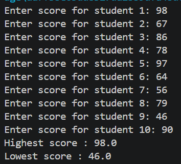
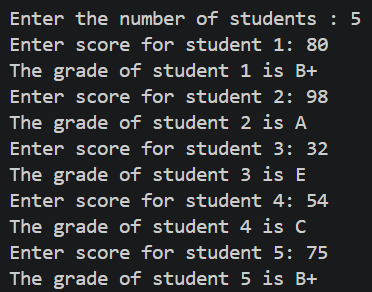
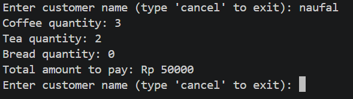
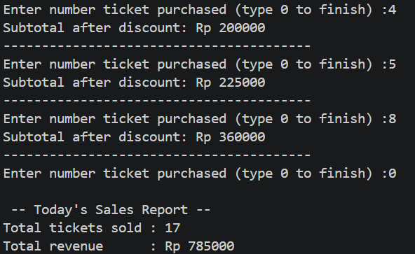
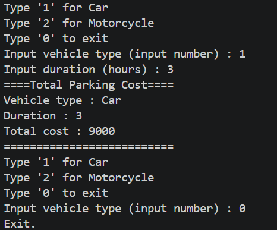

# JOBSHEET 7 - LOOPS 1

**Student Identity:**

- **Name:** Muhamad Dzaky Ammar Naufal
- **Student ID (NIM):** 264107020222
- **Class / Attendance No.:** 1I / 21

---

## 1: PRACTICAL OBJECTIVES

The objectives of this practical session are:

1. Students are able to explain the syntax for writing loop programs (`for`, `while`, and `do-while`).
2. Students are able to implement loop flowcharts using the Java programming language.

---

## 2: EXPERIMENT RESULTS AND ANALYSIS

### 2.1 Experiment 1: Student Grades Case Study in SIAKAD – FOR Loop

This experiment uses a `for` loop to input the quiz scores of 10 students. The program compares each score to find the highest and lowest scores in the class.

#### 2.1.1 Java Program Code

```java
package week9;
import java.util.Scanner;
public class SiakadForAttendance21 {
    public static void main(String[] args) {
        Scanner sc = new Scanner(System.in);

        double score, highest = 0, lowest = 100;

        for (int i = 1; i <= 10; i++) {
            System.out.print("Enter score for student " + i + ": ");
            score = sc.nextDouble();
            if (score > highest) {
                highest = score;
            }
            if (score < lowest) {
                lowest = score;
            }
        }
         
        System.out.println("Highest score : " + highest);
        System.out.println("Lowest score : " + lowest);

        sc.close();
    }
}

```

#### 2.1.2 Program Output



#### 2.1.3 Answers to Questions / Reflection Questions

* **Question 1:** Identify and indicate each component of the FOR loop in the program code of Experiment 1!
  * **Answer:** The `for` loop is `for (int i = 1; i <= 10; i++)`.
    - **Initialization:** `int i = 1`, which sets the counter's starting value to 1.
    - **Condition:** `i <= 10`, which allows the loop to run while `i` is less than or equal to 10.
    - **Update:** `i++`, which increases `i` by 1 after each loop.
    - **Loop body:** The statements inside `{ }` that input and compare each student's score.

* **Question 2:** Why is the variable `highest` initialized to 0 and the variable `lowest` initialized to 100? What happens if `highest` is initialized to 100 and `lowest` is initialized to 0?
  * **Answer:** The score range is 0 to 100. `highest` starts at 0 so the first valid score can replace it if the score is higher. `lowest` starts at 100 so the first valid score can replace it if the score is lower. If `highest` starts at 100 and `lowest` starts at 0, normal scores will usually not change those values. The program may incorrectly display 100 as the highest score and 0 as the lowest score.

* **Question 3:** Explain the function and workflow of the following code snippet!
  * **Answer:** The first `if` checks whether the current score is greater than `highest`. If it is, `highest` is updated with that score. The second `if` checks whether the current score is lower than `lowest`. If it is, `lowest` is updated. This process is repeated for every student, so the variables keep the highest and lowest scores found so far.

* **Question 4:** Modify the program to count how many students pass and how many students fail, based on the passing threshold (minimum score of 60). Display the number of students who pass and fail after displaying the highest and lowest scores!
  * **Answer:** Add two counter variables, for example `passCount` and `failCount`, and initialize both to `0`. Inside the loop, after reading each score, check whether the score is at least 60. If `score >= 60`, increase `passCount` by 1. Otherwise, increase `failCount` by 1. After the loop, display both counters after displaying the highest and lowest scores.

* **Question 5:** Commit and push the program code to GitHub.
  * **Answer:** This is a practical instruction. After the Java program is completed and tested, save the changes with a Git commit and push the commit to the GitHub repository.

---

### 2.2 Experiment 2: Student Grades Case Study in SIAKAD – WHILE Loop

This experiment uses a `while` loop to process scores for a number of students entered by the user. The program checks whether each score is valid and then displays its letter grade.

#### 2.2.1 Java Program Code

```java
package week9;
import java.util.Scanner;
public class SiakadWhileAttendance21 {
    public static void main(String[] args) {
        Scanner sc = new Scanner(System.in);

        int studentCount;
        int score;
        int i = 0;

        System.out.print("Enter the number of students : ");
        studentCount = sc.nextInt();

        while (i < studentCount) {
            System.out.print("Enter score for student " + (i + 1) + ": ");
            score = sc.nextInt();

            if (score < 0 || score > 100) {
                System.out.println("Invalid score. Please enter a valid score!");
                continue;
            }
            if (score > 88 && score <= 100) {
                System.out.println("The grade of student " + (i + 1) + " is A");
            } else if (score > 73 && score <= 100) {
                System.out.println("The grade of student " + (i + 1) + " is B+");
            } else if (score > 65 && score <= 73) {
                System.out.println("The grade of student " + (i + 1) + " is B");
            } else if (score > 60 && score <= 65) {
                System.out.println("The grade of student " + (i + 1) + " is C+");
            } else if (score > 50 && score <= 60) {
                System.out.println("The grade of student " + (i + 1) + " is C");
            } else if (score > 39 && score <= 50) {
                System.out.println("The grade of student " + (i + 1) + " is D");
            } else {
                System.out.println("The grade of student " + (i + 1) + " is E");
            }
            i++;

            sc.close();
        }
    }
}
```

#### 2.2.2 Program Output



#### 2.2.3 Answers to Questions / Reflection Questions

* **Question 1:** In the following code snippet, determine the meaning and purpose of the following syntax:
  * **a. `score < 0 || score > 100`**
    * **Answer:** This condition checks whether the score is outside the valid range. The `||` operator means OR. Therefore, the condition is true if the score is below 0 or above 100.
  * **b. `continue`**
    * **Answer:** `continue` skips the remaining statements in the current loop iteration and returns to the next loop check. In this program, it makes the user enter the score again without counting the invalid score as a completed student.

* **Question 2:** Why is the `i++` statement written at the end of the WHILE loop? What happens if it is written at the beginning of the WHILE loop?
  * **Answer:** It is placed at the end so the student number increases after a valid score has been processed. If it is placed at the beginning, the first student will be displayed as student 2 instead of student 1 because `i` starts at 0. The counter would also increase before the score is processed.

* **Question 3:** If the number of students entered is 19, how many times will the WHILE loop run?
  * **Answer:** The loop processes **19 valid student scores**. If an invalid score is entered, `continue` makes the program ask for that student's score again, so the loop body may execute more than 19 times in total.

* **Question 4:** Modify the program so that, if a student receives grade A, the program displays an additional message “Well done, keep up the good work!”
  * **Answer:** Add a second `System.out.println` inside the `if` block for grade A, so the message is only displayed when the score is in the A range:

    ```java
    if (score > 88 && score <= 100) {
        System.out.println("The grade of student " + (i + 1) + " is A");
        System.out.println("Well done, keep up the good work!");
    }
    ```

---

### 2.3 Experiment 3: Café Transaction Case Study – DO-WHILE Loop

This experiment uses a `do-while` loop to process café transactions. The program asks for a customer's name and the quantities of the menu items. The transaction process stops when the cashier enters `cancel`.

#### 2.3.1 Java Program Code

```java
package week9;
import java.util.Scanner;
public class CafeDoWhileAttendance21 {
    public static void main(String[] args) {
        Scanner sc = new Scanner(System.in);

        int coffee, tea, bread;
        int coffeePrice = 12000, teaPrice = 7000, breadPrice = 20000;
        int totalPrice;
        String customerName;

        do {
            System.out.print("Enter customer name (type 'cancel' to exit): ");
            customerName = sc.nextLine();

            if (customerName.equalsIgnoreCase("cancel")) {
                System.out.println("Transaction canceled.");
                break;
            }

            System.out.print("Coffee quantity: ");
            coffee = sc.nextInt();
            System.out.print("Tea quantity: ");
            tea = sc.nextInt();
            System.out.print("Bread quantity: ");
            bread = sc.nextInt();
            totalPrice = (coffee * coffeePrice) + (tea * teaPrice) + (bread * breadPrice);
            System.out.println("Total amount to pay: Rp " + totalPrice);
            sc.nextLine();
        } while (true);

        System.out.println("All transactions completed.");

        sc.close();
    }
}

```

#### 2.3.2 Program Output



#### 2.3.3 Answers to Questions / Reflection Questions

* **Question 1:** In this DO-WHILE loop, if the first customer name entered is “cancel”, how many times is the loop executed?
  * **Answer:** The loop is executed **once**. A `do-while` loop runs its body before checking the condition. The program then detects `cancel` and executes `break` to stop the loop.

* **Question 2:** State the stopping condition used in this DO-WHILE loop!
  * **Answer:** The program stops when the customer enters `cancel`. The `break` statement exits the loop immediately. The `while (true)` condition itself does not stop the loop.

* **Question 3:** What is the function of using the value `true` in the DO-WHILE condition?
  * **Answer:** The value `true` makes the loop condition always true. Therefore, the loop keeps repeating until a `break` statement is executed.

* **Question 4:** Why does this DO-WHILE loop still run even though it has no initialization and update components?
  * **Answer:** A `do-while` loop does not require initialization and update components like a `for` loop. It runs the statements inside `do` first, then checks its condition. In this program, `while (true)` keeps it running, while `break` provides a way to stop it.

---

## 3: INDEPENDENT ASSIGNMENTS

The following assignments apply loop structures and selection statements to solve practical problems.

### 3.1 Assignment 1: Cinema Ticket Sales

The program calculates the total number of tickets sold and the total ticket sales revenue for one day. Each ticket costs Rp 50,000. Customers who buy more than 4 tickets receive a 10% discount, while customers who buy more than 10 tickets receive a 15% discount. Negative quantities must be rejected and entered again.

#### 3.1.1 Java Program Code

```java
package week9;
import java.util.Scanner;
public class CinemaTicketsAssignment1 {
    public static void main(String[] args) {
        Scanner sc = new Scanner(System.in);

        double ticketPrice = 50000;

        //input
        while (true) {
            System.out.print("Total ticket purchased (type '0' to cancel) : ");
            int ticketTotal = sc.nextInt();

            if (ticketTotal == 0) {
                System.out.println("Canceled.");
                break;
            } if (ticketTotal < 0) {
                System.out.println("invalid input, dont input less than 0!");
                continue;
            }
        
            double discount = 0;

            

            if (ticketTotal >4 && ticketTotal <= 10) {
                discount = 0.1;
            } if (ticketTotal > 10) {
                discount = 0.15;
            }

            //calculation
            double totalPrice = ticketPrice * ticketTotal;
            double discountAmount = ticketPrice * discount * ticketTotal;
            double total = totalPrice - discountAmount;

            //output
            System.out.println("=====Ticket Transactions=====");
            System.out.println("Ticket sold : " + ticketTotal);
            System.out.println("Discount : " + discount);
            System.out.println("Total revenue : " + (int) total);
            System.out.println("=============================");
        }
        sc.close();
    }
}
```

#### 3.1.2 Program Output

The following is the program output after execution:



---

### 3.2 Assignment 2: Parking Fee Calculation

The program calculates parking fees for several vehicles. The rate is Rp 3,000 per hour for cars and Rp 2,000 per hour for motorcycles. The program continues asking for vehicle input until the user enters `0`, according to the provided flowchart.

#### 3.2.1 Java Program Code

```java
package week9;
import java.util.Scanner;
public class FeeParking {
    public static void main(String[] args) {
        Scanner sc = new Scanner(System.in);

        int type;
        int duration = 0;
        int total = 0;

        do {
            System.out.print("Type '1' for Car \nType '2' for Motorcycle \nType '0' to exit \nInput vehicle type (input number) : ");
            type = sc.nextInt();
            if (type == 1 || type == 2) {
                System.out.print("Input duration (hours) : ");
                duration = sc.nextInt();
            } if (type == 1) {
                total = duration * 3000;
            } else if (type == 2) {
                total = duration * 2000;
            }

        if (type == 1) {
            System.out.println("====Total Parking Cost====");
            System.out.println("Vehicle type : Car");
            System.out.println("Duration : " + duration);
            System.out.println("Total cost : " + total);
            System.out.println("==========================");
        }

        if (type == 2) {
            System.out.println("====Total Parking Cost====");
            System.out.println("Vehicle type : Motorcycle");
            System.out.println("Duration : " + duration);
            System.out.println("Total cost : " + total);
            System.out.println("==========================");
        }
        
        } while (type != 0); 
        System.out.println("Exit.");

        sc.close();


    }
}

```

#### 3.2.2 Program Output



---

## 4: CONCLUSION

The `for`, `while`, and `do-while` loops in Java support different repetition patterns. A `for` loop is suitable when the number of iterations is known, a `while` loop repeats based on a condition, and a `do-while` loop executes its body at least once before checking the condition.

Loop counters, score comparisons, input validation, and control statements such as `continue` and `break` allow programs to process student data, transactions, ticket sales, and parking fees correctly.